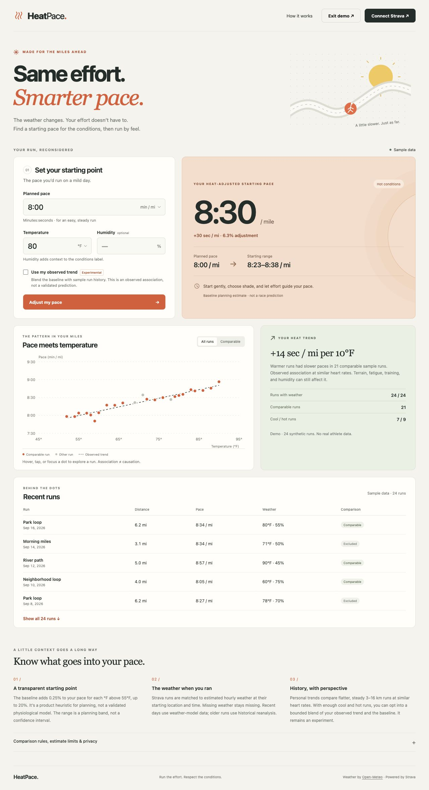
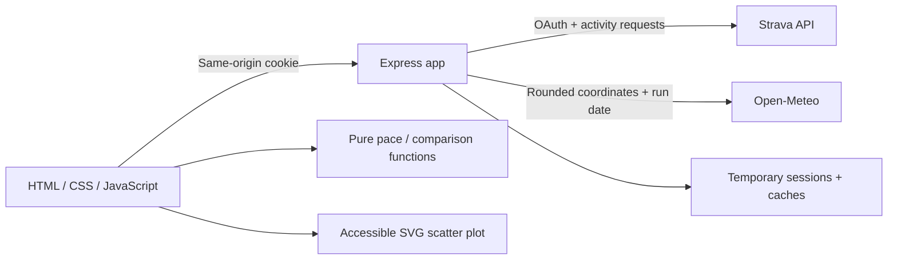

# HeatPace

**Same effort. Smarter pace.** A weather-aware run planner with Strava history, hourly historical weather, and an explained pace estimate.

HeatPace started as a solo running hackathon project. Version 2 turns that prototype into a focused portfolio app: a usable mobile interface, a zero-account demo, safer authentication, realistic missing-data handling, and tested calculations.



[View the mobile preview](docs/heatpace-mobile.jpg).

## Try it locally

Requires Node.js 22 or newer.

```sh
npm run setup
npm start
```

Open **http://localhost:3001**. The calculator and **Try demo** work immediately, without API keys. **http://localhost:3001/?demo=1** opens the sample history directly. The demo contains 24 synthetic runs, not real athlete data.

For development, use `npm run dev`. For checks, use `npm test`.

## What you can do

- Enter a mild-day pace and temperature, with optional humidity context.
- Switch between miles/kilometers and Fahrenheit/Celsius; inputs and history convert together.
- See the adjusted starting pace, change from the plan, and a planning range.
- Explore a scatter plot using a mouse, touch, or keyboard, and inspect the supporting run table.
- Connect Strava to load up to 60 recent road runs from the last 180 days, matched to estimated weather at the start hour.
- Opt into an experimental personal trend when enough comparable runs are available.
- Use everything except live history without a Strava account.

## Strava setup

1. Create an API application at [Strava API settings](https://www.strava.com/settings/api).
2. Set its Authorization Callback Domain to `localhost` for local development (no scheme, path, or port).
3. Copy `.env.example` to `.env` in the repository root and fill in `STRAVA_CLIENT_ID` and `STRAVA_CLIENT_SECRET`.
4. Keep `APP_ORIGIN=http://localhost:3001` for local use. Visit that exact origin, rather than `127.0.0.1`, so the authorization callback and cookies use the same host.
5. Restart the app and select **Connect Strava**.

The callback is `/api/auth/callback`. The app requests only `activity:read`, which excludes Only You activities. Heart-rate and start-location data can be missing; those runs remain visible but do not qualify for a personal trend. Strava application approval and athlete limits still apply; see the [developer documentation](https://developers.strava.com/docs/getting-started/).

The old OpenWeather `WEATHER_KEY` is no longer used. Historical weather comes from Open-Meteo, whose free endpoint supports this non-commercial portfolio use without an API key. Read [Open-Meteo's terms](https://open-meteo.com/en/terms) before changing the use case.

## How the estimate works

This is an **explicit product heuristic, not a clinically or physiologically validated prediction**. It estimates a starting pace for easy, steady runs. It does not prescribe a safe pace in extreme weather or predict a race result.

### Baseline

Internal pace units are seconds per mile; internal temperature units are °F.

```text
adjustment percentage = clamp((temperature − 55°F) × 0.25%, 0%, 20%)
adjusted pace = planned pace × (1 + adjustment percentage / 100)
```

Example: 8:00/mile at 80°F becomes 8:30/mile, a 6.25% increase in seconds per mile. At or below 55°F there is no heat adjustment. A 0.25%/°F slope and 55°F reference are design choices, not values fitted to a research dataset.

The displayed range uses 75–125% of the calculated extra seconds. It is a **planning band**, not a statistical confidence interval. Humidity affects a heuristic conditions label, not the pace correction: above 70°F the label uses temperature plus 0.12°F per humidity percentage point above 50%. Neither this label nor its high-heat threshold is a formal heat index or safety assessment.

### Personal history

A comparison cohort includes outdoor runs that meet all of these requirements:

- Distance between 3 and 16 km.
- No race/workout tag (`workout_type` absent or zero).
- At most 15 m of ascent per kilometer.
- Elapsed time no more than 1.25 times moving time.
- Valid hourly weather and heart rate, with average heart rate within 10 bpm of the cohort median.

A personal trend requires at least 12 comparable runs, at least 3 at or below 60°F, and at least 3 at or above 75°F. Ordinary least-squares regression relates pace to the **actual temperatures**, rather than dividing a hot/cool difference by a fixed temperature gap. Only a positive slope with R² ≥ 0.15 enables the option. Those eligibility thresholds are conservative product gates, not proof of statistical validity.

After explicit opt-in, the observed slope is normalized by average cool-run pace, bounded to 0.1–0.6% per °F, and blended with the 0.25%/°F baseline. The observed trend's weight is `min(comparable run count / 60, 0.5)`. The overall correction stays capped at 20%.

Even comparable runs are affected by fitness changes, fatigue, training intent, wind, humidity, sun, and terrain. The trend represents an association, not a causal heat-sensitivity classification. Validation against held-out real runs remains future work; the demo illustrates behavior rather than accuracy.

### Weather provenance

The server matches each run's UTC start date and containing hour to Open-Meteo hourly temperature and humidity. Coordinates are rounded to two decimal places (approximately 1 km, varying by latitude).

- Runs at least seven days old use [ERA5 historical reanalysis](https://open-meteo.com/en/docs/historical-weather-api). ERA5 is a modeled estimate with approximately 25 km spatial resolution, not a measurement on the runner's route.
- More recent runs use the [forecast API's past-date range](https://open-meteo.com/en/docs), giving weather-model estimates while the archive catches up.
- Failed or missing weather stays `null`; there is no fabricated 70°F fallback.
- Each run includes a source/status field; indoor and missing-location runs are marked separately.

Weather is estimated at the starting point and hour, not averaged across a route or run duration.

## Architecture



The same Express app serves the frontend and `/api` routes, so local development and production use one origin. There is no frontend build step, chart CDN, or framework runtime. Calculation functions are independent of the DOM and shared with normalization code on the server.

| File | Responsibility |
| --- | --- |
| `frontend/js/heatScore.js` | Parsing, units, validation, baseline model, cohort selection, regression |
| `frontend/js/app.js` | Form, connection state, demo, results, table |
| `frontend/js/chart.js` | SVG scatter plot and keyboard/pointer inspection |
| `backend/app.js` | HTTP routes, sessions, OAuth state, response protection |
| `backend/integrations.js` | Token refresh, pagination, normalization, hourly weather, enrichment |
| `backend/server.js` | Root environment loading and server startup |
| `tests/` | Node test suite with mocked provider responses |

## Authentication, privacy & operational limits

- Access and refresh tokens remain in server memory. The browser receives a random opaque `HttpOnly`, `SameSite=Lax` cookie (`Secure` in production).
- OAuth state is random, single-use, bound to the initiating session, and expires after 10 minutes. Successful authorization rotates the session ID.
- Access tokens refresh before expiry; concurrent requests share a refresh operation so rotating refresh tokens do not race.
- No tokens are accepted from or returned in URLs. Provider payloads and authorization codes are not logged.
- Disconnect deletes the local session; it does **not** revoke Strava authorization. Athletes can revoke access in their Strava settings.
- Sessions expire after seven days and disappear on server restart. This is intentionally a **single-instance portfolio deployment**. A durable encrypted token store and shared session/cache store are needed before scaling to multiple instances.
- Weather lookups send approximate locations and dates to Open-Meteo. Precise coordinates are stripped from activity responses; run data is not written to disk or local storage.
- Historical weather is cached for 24 hours; recent model data for one hour. Session activity results are cached for 15 minutes. Concurrent loads share their work.
- Retrieval is bounded to three Strava pages of 100 activities and 60 enriched road runs. Weather uses three workers and stops starting new lookups after 30 seconds. Missing weather is reported, so provider failures reduce coverage instead of inventing data.
- Basic request limits, JSON payload limits, provider timeouts, and a same-origin disconnect check are included. API responses are not browser-cacheable. Frontend scripts and styles are served locally under a restrictive content policy.

## Deploying

Version 2 replaces the original split Netlify/Render deployment with **one full-stack Node service**. Deploy the repository root to a Node host such as Render:

```text
Build command: npm ci --prefix backend
Start command: npm start
Health check: /api/health
Node version: 22+
```

Set `NODE_ENV=production`, `APP_ORIGIN=https://your-app-hostname`, and both Strava credentials in the host's environment settings. The host supplies `PORT`. Update the Strava callback domain to that public hostname. HTTPS is required in production.

The existing Netlify page and legacy callback path will not become v2 automatically. Do not deploy just `frontend/` and expect live authentication to work: the browser and API need the same origin. Deployment has not been performed as part of this upgrade.

## Verification

`npm test` runs model, integration, and HTTP tests using Node's built-in runner. Provider requests are mocked: the suite needs no credentials and does not access athlete data. HTTP tests open temporary localhost ports.

Coverage includes malformed paces, second carry, equivalent units, continuous adjustments, humidity behavior, personal-trend gates and bounds, heart-rate filtering, UTC weather matching, missing weather, pagination, location stripping, refresh coalescing, OAuth state/replay/expiry, cookie flags, disconnect, API caching, upstream errors, and request limits. GitHub Actions runs the same checks on pushes and pull requests.

Manual review covers the baseline, demo, opt-in estimate, chart interaction, validation errors, units, table expansion, and desktop/mobile layout. Real Strava consent and activity access require a configured application and an athlete login; mocked success does not verify those external permissions.

## Portfolio talking points

- Built a full-stack running planner integrating Strava OAuth and hourly historical weather, with an accessible sample-data demo.
- Implemented secure server-held token sessions, refresh coalescing, bounded API requests, and explicit missing-data handling.
- Designed a transparent pace heuristic and opt-in regression-based personalization with comparable-run filters and documented limitations.

Avoid claiming validated accuracy or user adoption without measuring them. Useful next evidence would be held-out prediction error, comparison against the baseline, and feedback from a few runners.

## Background

The original hackathon version came from a personal running problem: hot days made a familiar pace feel harder, and I wanted a practical way to adjust. It established the frontend, Strava integration, and initial visualization. Version 2 retains that focused idea while addressing the prototype's current-weather mismatch, fixed pace correction, URL tokens, and hidden demo.
